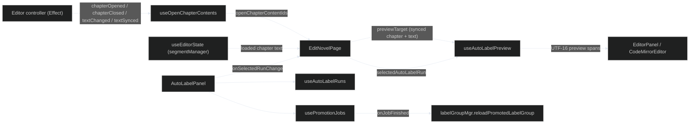
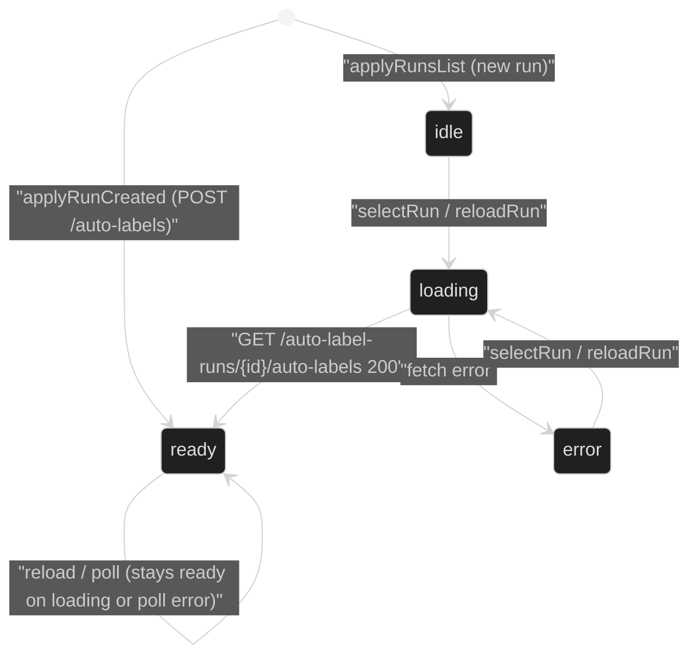
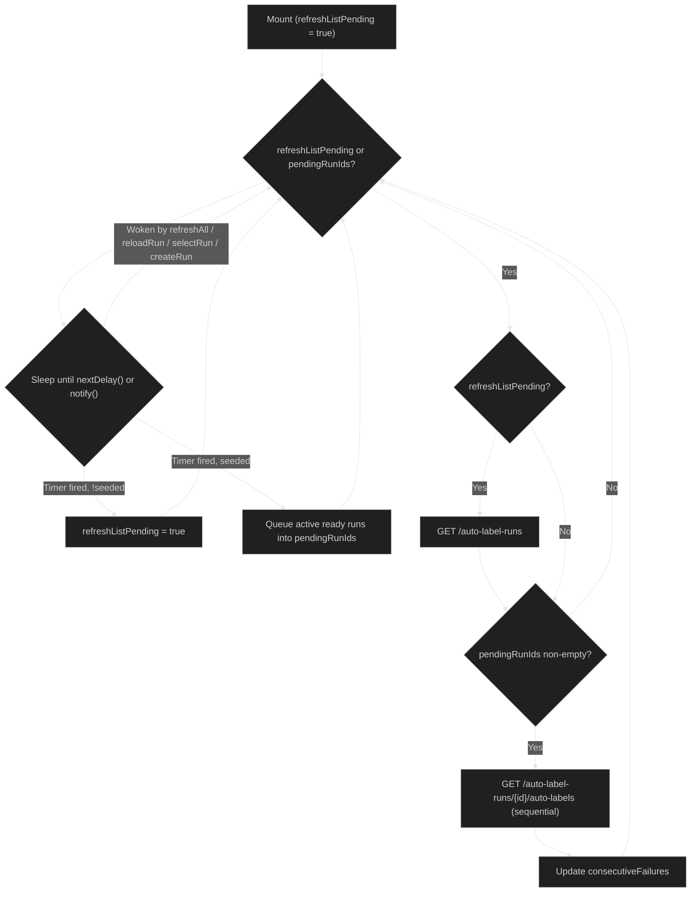

# Autolabels UI and editor preview boundary

Implementation notes for the frontend autolabels modules under `frontend/src/autolabels/`
and their boundary with the editor controller.

## Source map

| Responsibility | Source |
| --- | --- |
| Run state, pure reducers, match status | [autoLabelRunsState.ts](../../frontend/src/autolabels/runs/autoLabelRunsState.ts) |
| Run list loading, polling, creation | [useAutoLabelRuns.ts](../../frontend/src/autolabels/runs/useAutoLabelRuns.ts) |
| Prop-only runs list and creation form | [AutoLabelRunsList.tsx](../../frontend/src/autolabels/runs/AutoLabelRunsList.tsx), [CreateAutoLabelPanel.tsx](../../frontend/src/autolabels/runs/CreateAutoLabelPanel.tsx) |
| Promotion job polling and UI | [usePromotionJobs.ts](../../frontend/src/autolabels/promotions/usePromotionJobs.ts), [PromotionJobsList.tsx](../../frontend/src/autolabels/promotions/PromotionJobsList.tsx) |
| Panel wiring and promotion dialog | [AutoLabelPanel.tsx](../../frontend/src/edit/panels/autoLabels/AutoLabelPanel.tsx), [PromoteAutoLabelDialog.tsx](../../frontend/src/edit/panels/autoLabels/PromoteAutoLabelDialog.tsx) |
| Synced open-chapter content tracker | [useOpenChapterContents.ts](../../frontend/src/edit/hooks/useOpenChapterContents.ts) |
| Live preview fetch, cache, UTF-16 spans | [useAutoLabelPreview.ts](../../frontend/src/autolabels/preview/useAutoLabelPreview.ts) |
| Editor page wiring | [EditNovelPage.tsx](../../frontend/src/edit/pages/EditNovelPage.tsx) |

## Ownership and data flow

The Effect editor controller stores no autolabel state. Data crosses the editor
boundary in one direction only: `createOpenChapterContentsSubscriber` listens to
`chapterOpened`, `chapterClosed`, `textChanged`, and `textSynced` and exposes
`openChapterContentIds` (`chapterServerId -> synced chapterContentServerId | null`).

- `AutoLabelPanel` is mounted with `keepMounted: true` and `key={novel.novel.novelId}` in
  [EditNovelPage.tsx](../../frontend/src/edit/pages/EditNovelPage.tsx), so switching
  right-panel tabs keeps polling alive while switching novels remounts both hooks.
- When `textChanged` fires, `openChapterContentIds` sets that chapter's entry to `null`,
  which drops `previewTarget` to `null` on the same render and aborts any in-flight
  preview request in `useAutoLabelPreview`.

## Run entry state machine

Defined in [autoLabelRunsState.ts](../../frontend/src/autolabels/runs/autoLabelRunsState.ts).

- `applyRunLoading` and `applyRunError` are intentional no-ops when an entry is already
  `ready`, so background reloads and transient poll failures do not wipe loaded chapter
  statuses or stop backoff retries.
- A `ready` entry is considered active (`isRunActive`) when its derived `overallStatus` is
  `pending` or `processing`.

## Read loop in `useAutoLabelRuns`

[useAutoLabelRuns.ts](../../frontend/src/autolabels/runs/useAutoLabelRuns.ts) runs a single
async consumer loop per `novelId` so at most one read sequence is in flight at a time.

- `nextDelay()` returns `null` when `seeded && !hasActiveRuns()`, parking the loop with no
  timer until a user action calls `notify()`.
- While unseeded or while any loaded run is active, `nextDelay()` starts at 2 s, backs off
  up to 15 s (`MAX_IDLE_POLL_INTERVAL_MS`) across unchanged timer polls (resetting to 2 s
  on progress or manual action), and up to 30 s on consecutive failures.
- Cleanup on unmount or `novelId` change aborts in-flight fetches, exits the loop, and
  resets state.

## Preview fetch lifecycle

[useAutoLabelPreview.ts](../../frontend/src/autolabels/preview/useAutoLabelPreview.ts) derives
`matchingAutoLabelId`, `needsFetch`, `loading`, and `preview` during render from
`(enabled, selectedRun, target, cache, failedKey)`:

- The `useEffect` only runs `GET /auto-labels/{autoLabelId}` when `needsFetch` is true and
  aborts via `AbortController` on cleanup.
- Results are cached in state by `autoLabelId` and converted to UTF-16 spans via
  `labelsToUtf16(target.text, cachedLabels)`.
- Re-enabling preview increments `attempt`, allowing retry after a failed fetch without
  refetching cached entries.
