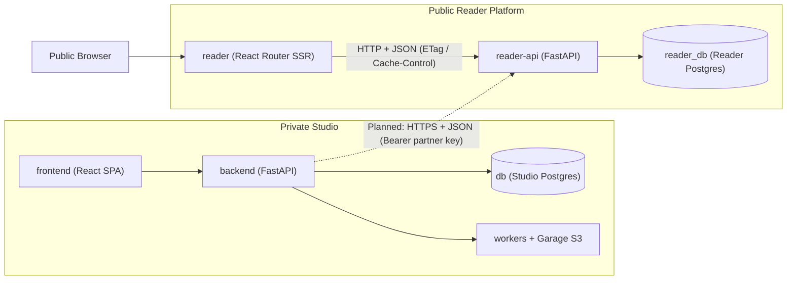
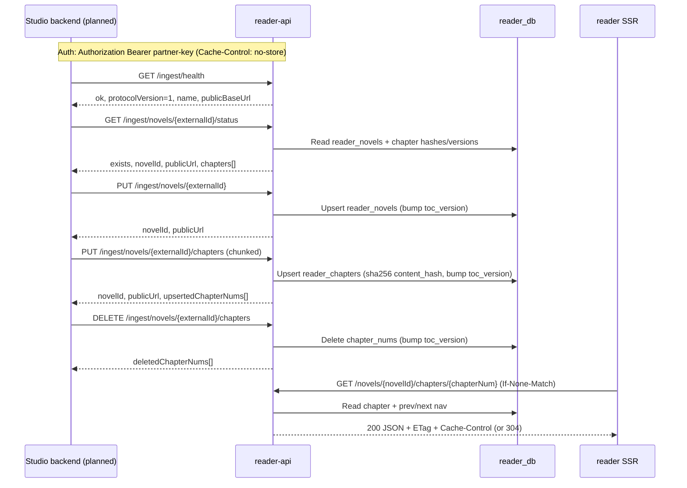

# Reader architecture and publishing plans

Current status as of 2026-11-26:
- **Implemented (`master`):** Translation output staging, right-panel review, and DB-side accept into translated novels ([outputs.py](../../backend/src/translations/outputs.py), [TranslationReviewPanel.tsx](../../frontend/src/edit/panels/translations/TranslationReviewPanel.tsx)).
- **Implemented (`feature/reader-api`, PR #161):** Standalone [reader-api](../../reader-api/src/main.py) FastAPI service backed by its own PostgreSQL database (`reader_db`), plus [reader](../../reader/app/lib/api.server.ts) SSR app repointed to `reader-api`.
- **Planned (Slices 3–5):** Studio publishing integration (`backend/src/publishing/` + Publish Dialog in `frontend/`) and anonymous rate-limited reader feedback with JSONL export for `analytics/`.

## Service split and boundaries

Studio stays private (local / Tailscale / home hardware for CPU-heavy workers and editing). The public Reader platform is an independent deployment with its own Postgres database and no network dependency back to Studio. Studio visibility (`novel_visibility` / `chapter_is_public`) is Studio-internal only; external publishing is an explicit stateless push.

## Communication protocol (`protocolVersion: 1`)

All endpoints live in [ingest/router.py](../../reader-api/src/ingest/router.py) and [public/router.py](../../reader-api/src/public/router.py) with camelCase JSON schemas in [schemas.py](../../reader-api/src/schemas.py) and Bearer partner-key auth in [auth.py](../../reader-api/src/auth.py). Partner keys are managed via [manage_partners.py](../../reader-api/scripts/manage_partners.py) (SHA-256 hashed in `reader_partner_keys`, multiple active keys per partner with `revoked_at` for zero-downtime rotation).

Key contract details:
- `external_id` on `reader_novels` is nullable, immutable, partner-scoped (`UNIQUE(partner_id, external_id)`), and ingest-only — public endpoints never expose it.
- `content_hash` (SHA-256 of `body`) is computed and owned by `reader-api` for ETag generation and analytics; `external_version` is an optional opaque string (Studio sends latest `chapter_content_id`) for live diffing without mirroring published state in Studio's DB.
- `toc_version` on `reader_novels` increments on novel metadata updates and chapter upserts/deletes so TOC ETags invalidate cleanly.
- `reader/` generates its Orval client from [reader-api/openapi.json](../../reader-api/openapi.json) via [reader/orval.config.ts](../../reader/orval.config.ts) and calls `reader-api` server-side through [backend-fetch.ts](../../reader/app/api/backend-fetch.ts) (`READER_BACKEND_URL`).

## Schema and migrations

Models live in [reader-api/src/models.py](../../reader-api/src/models.py) with Alembic migrations in [reader-api/alembic/versions](../../reader-api/alembic/versions/) (`compare_type=True` and `compare_server_default=True` in [reader-api/alembic/env.py](../../reader-api/alembic/env.py)). The test harness in [reader-api/tests/conftest.py](../../reader-api/tests/conftest.py) runs `alembic upgrade head` followed by `alembic check` against `reader_test` so model-migration drift fails tests.

## Planned next slices

- **Slice 3 (Studio publishing backend):** `backend/src/publishing/` with per-user `publishing_targets` (Fernet-encrypted API keys + env default target), SSRF guard, healthcheck-on-save (`GET /ingest/health`), live status diff (`GET /ingest/novels/{externalId}/status`), and chunked publish/unpublish endpoints.
- **Slice 4 (Studio Publish Dialog):** Target management and novel/chapter publish status diff UI in `frontend/`.
- **Slice 5 (Reader feedback):** Anonymous rate-limited `reader_feedback` table + endpoint in `reader-api/`, progressive-enhancement form in `reader/`, and `reader_feedback.v1` JSONL export for [analytics](analytics.md).
- **CI / images:** Add `reader-api` ruff/pyrefly/pytest jobs and GHCR image builds (`noveltl-reader-api`, `noveltl-reader-api-dev`) to `.github/workflows/`.
