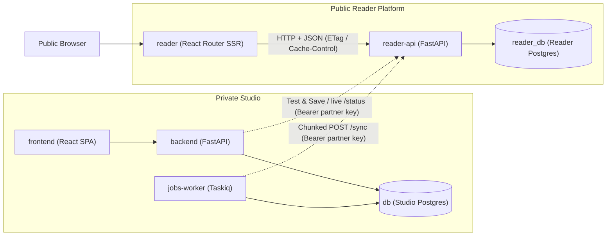
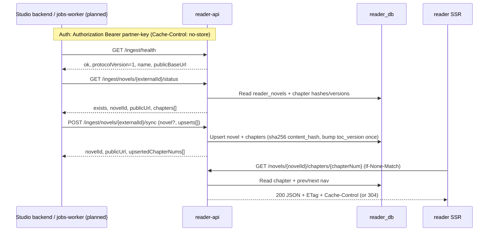

# Reader architecture and publishing plans

Current status as of 2026-11-27:
- **Implemented (`master`):** Translation output staging, right-panel review, and DB-side accept ([outputs.py](../../backend/src/translations/outputs.py), [TranslationReviewPanel.tsx](../../frontend/src/edit/panels/translations/TranslationReviewPanel.tsx)); standalone [reader-api](../../reader-api/src/main.py) FastAPI service backed by `reader_db`, plus [reader](../../reader/app/lib/api.server.ts) SSR app.
- **Implemented (`feature/reader-admin-and-sync`):** Unified additive/update-only `POST /ingest/novels/{externalId}/sync`, env-configured Reader Admin (`/admin/*` in [admin/router.py](../../reader-api/src/admin/router.py), `/admin/dashboard` & `/admin/login` SSR routes in [admin.dashboard.tsx](../../reader/app/routes/admin.dashboard.tsx)), and [reader-api.yml](../../.github/workflows/reader-api.yml) CI workflow.
- **Planned (Slices 3–5):** Studio publishing backend + Settings/Publish UI (`backend/src/publishing/`, `frontend/`) and mobile-first mascot Reader Feedback (`reader-api/`, `reader/`, `analytics/`).

## Service split and boundaries

Studio stays private (local / Tailscale / home hardware for CPU-heavy workers and editing). The public Reader platform (`reader` + `reader-api` + `reader_db`, no Redis required) is an independent deployment with no network dependency back to Studio. Studio visibility (`novel_visibility` / `chapter_is_public`) is Studio-internal only; external publishing is an explicit range-based sync.

## Communication protocol (`protocolVersion: 1`)

Ingest endpoints live in [ingest/router.py](../../reader-api/src/ingest/router.py), admin endpoints in [admin/router.py](../../reader-api/src/admin/router.py), and public read endpoints in [public/router.py](../../reader-api/src/public/router.py) with camelCase JSON schemas in [schemas.py](../../reader-api/src/schemas.py). Partner keys are Bearer `rapi_...` tokens hashed with SHA-256 in `reader_partner_keys` ([auth.py](../../reader-api/src/auth.py)), manageable via [manage_partners.py](../../reader-api/scripts/manage_partners.py) or `/admin`.

Key contract details:
- `external_id` on `reader_novels` is partner-scoped (`UNIQUE(partner_id, external_id)`), immutable, and ingest-only. Chapters key on `(novel_id, chapter_num)`.
- Partner ingest is strictly **additive/update-only** (no partner delete endpoints); only Reader Admin deletes novels or chapters (`DELETE /admin/novels/{novelId}`, `DELETE /admin/novels/{novelId}/chapters/{chapterNum}`).
- `content_hash` (SHA-256 of `body`) is computed by `reader-api` for ETags and analytics; `external_version` stores Studio's `chapter_content_id` for live diffing without mirroring published state in Studio's DB.
- Postgres `func.now()` is the single source of truth for timestamps in `reader-api`.
- Reader Admin auth ([admin/auth.py](../../reader-api/src/admin/auth.py)) currently uses env vars as a stopgap (`READER_ADMIN_USERNAME`, `READER_ADMIN_PASSWORD_HASH` via stdlib `scrypt`, `READER_ADMIN_SECRET` HMAC-SHA256 tokens) and `HttpOnly; SameSite=Lax` cookies in [admin.server.ts](../../reader/app/lib/admin.server.ts) — zero new DB tables and zero auth cookies on public reader routes. Follow-up if distributing `reader-api`: move admin users into a persistent `reader_admins` table in `reader_db`.

## Schema and migrations

Models live in [reader-api/src/models.py](../../reader-api/src/models.py) with Alembic migrations in [reader-api/alembic/versions](../../reader-api/alembic/versions/) (`compare_type=True` and `compare_server_default=True` in [reader-api/alembic/env.py](../../reader-api/alembic/env.py)). [reader-api/tests/conftest.py](../../reader-api/tests/conftest.py) runs `alembic upgrade head` + `alembic check` against `reader_test`.

## Planned next slices (agreed 2026-11-27)

- **Slice 3 (Studio publishing backend — `backend/src/publishing/`):**
  - DB targets only (no global env default): `publishing_targets` (Fernet-encrypted `rapi_...` key + `key_prefix`) and `user_publishing_targets` (`owner` / `publisher` roles).
  - SSRF guard (with `ALLOW_PRIVATE_PUBLISH_TARGETS=true` for local Compose), target CRUD + Test & Save (`GET /ingest/health`) + key rotation (`PATCH`), live status diff (`GET /novels/{novelId}/publish/status`).
  - Decoupled from `chapter_is_public`; novel editors/owners with target access can publish.
  - Range-based `publish_jobs` running on existing `jobs-worker` (Taskiq): partial unique index on active `(novel_id, target_id)`, single atomic `pending -> processing` flip (no `claim_token`), `cursor_chapter_num` stepping in 50-chapter chunks to `POST /ingest/novels/{externalId}/sync`, stale `updated_at` fails for manual retry.
- **Slice 4 (Studio Settings & Publish UI — `frontend/`):**
  - Dedicated `/settings` page (linked from user profile dropdown) for target management (Add/Test/Rotate/Delete/Share).
  - Novel editor Publish Dialog for target picker, live diff counts, range/outdated/all publish, job progress, and `"View on Reader ↗"`.
- **Slice 5 (Reader feedback & mascot — `reader-api/`, `reader/`, `analytics/`):**
  - Append-only `reader_feedback` table with typed envelope (`feedback_id`, `novel_id`, `chapter_id`, `chapter_num`, `content_hash`, `external_version`, `kind`, `client_hash`, `created_at`) + Pydantic-validated JSONB `payload` (`reaction`, `issue` with optional word/paragraph `anchor`, `comment`); keep v1 lightweight without heavy rate-limit infra until traffic warrants it.
  - Mobile-first UX in `reader/`: unobtrusive mascot below chapter text (above bottom `ChapterNav`) expanding inline (`
`) to quick emoji reactions + detailed feedback form, plus an opt-in top-bar "Feedback Mode" toggle where tapping a word pops up the mascot with pre-filled paragraph/character offsets (bottom sheet on mobile).
  - Pull-based analytics export: `GET /admin/feedback/export` NDJSON stream pulled by a private script into Garage S3 `exports/reader_feedback.v1/<until>.jsonl.gz` for [analytics](analytics.md).
